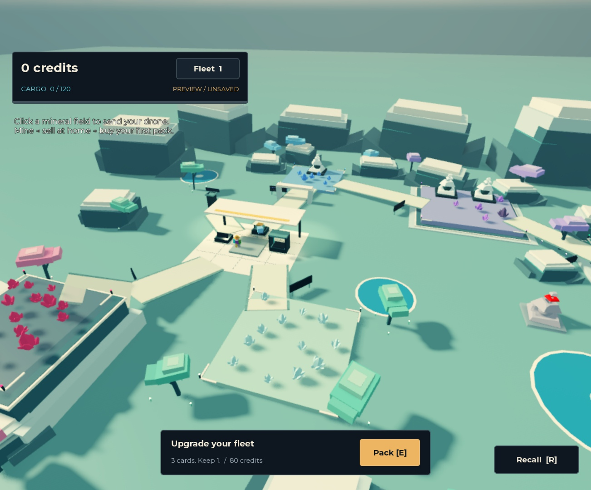
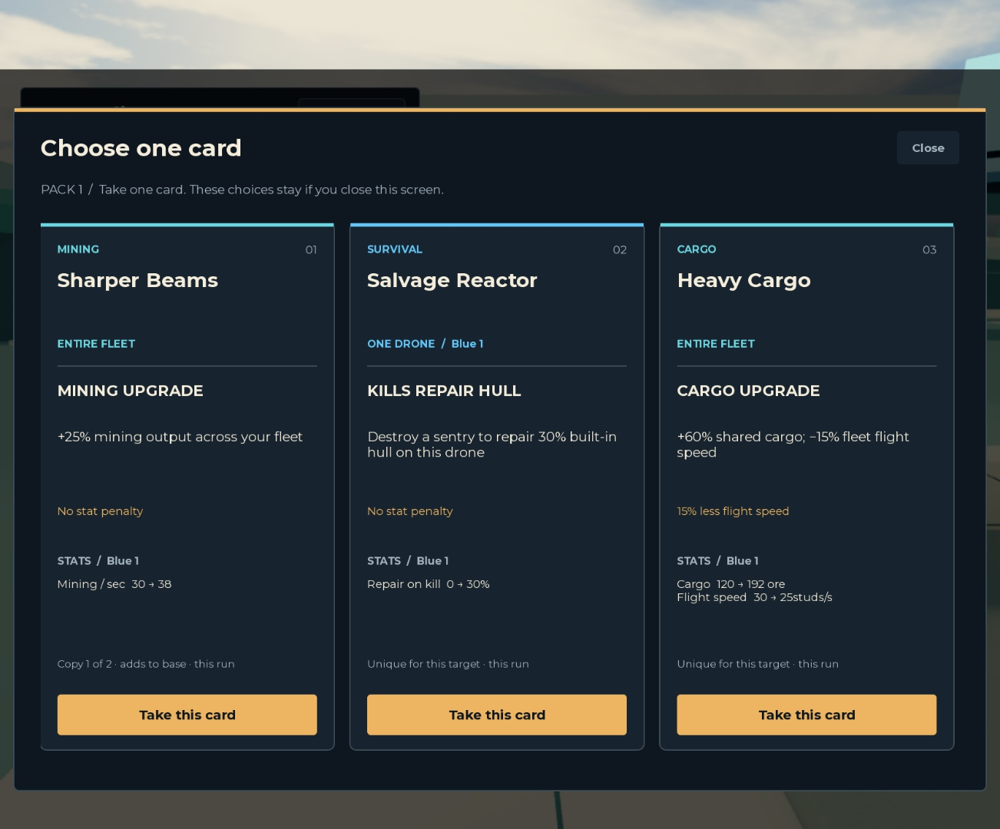

# Alabaster Reach, useful upgrades and game handbook

This is the current visual/upgrade review, superseding the older quarry polish report and pre-v3 progression readout. Source revision and exact place SHA-256 are recorded in `build/revision.json`; reproduce with `python3 tools/release.py`. No Roblox publication or new experience is part of this work.

## Player-visible result

- Rebuilt the runtime environment around the original spawn, Ruby/Cobalt fields, Converter, original trees, drone/crystal assets and segmented construct. The landscape uses chalk shelves, sloped teal talus, pale paths, saturated mineral pools, coral/cyan/lavender foliage, a sheltered depot, survey gate and small grounded survey pins. Prototype blocks are archived instead of left in the playable route. Original southern trees are grounded and proportionally reduced to at most 18 studs.
- Reworked lighting/materials: warm afternoon light, cool ambient fill, mint haze, slightly richer grading and a high-threshold modest bloom. Broad surfaces use clean low-poly materials; glow is concentrated on emitters and tiny markers. Alabaster Harbor was not available in connected Studio or local project searches; its assets/settings were not copied.
- Kept all original pyramid meshes, common pivots and live rig, while coordinating ceramic shell, dark teal housing, mint eyes, narrow two-layer telegraphs, warm charge and a faint single ground cue. Concurrent user-requested sentry animation work in the same workspace adds the `SentryMotion.lua` scan/idle/blink/charge/recoil driver; it is included by the current client bundle, independently checked for compatibility, and documented as cosmetic only.
- Strengthened weak card picks; added Bulwark Network, Courier Network, Siege Focus, Pulse Cannon, Prospector Rig and Shard Harvester. New offers use content version 3 and prioritize compatible useful combat/economy choices, plus a signature mechanic in early packs. Existing paid/selected v2 payloads retain their original effects.
- Card screens show the target, benefit, drawback, actual before/after values, per-run stacking and the name of the drone being previewed. Fleet previews skip a fully capped first unit when another unit actually benefits. Four preview rows accommodate combo effects.
- Added the browsable `docs/game/` handbook: architecture, map reference, full implemented game design, implementation/acceptance plan, upgrade-system guide, and all **41 standard + 3 reserve card outcomes** with exact formulas, conditions, caps and target rules.

## Two independent source review passes

**Behavior/parity and authority:** retained one permanent starter, immutable hardware, saved paid offers/targets, additive capped modifiers, server damage/rewards, finite assault lives, separate rendered poses and free reprint identity. Original flight/hover/overhead mining and quarter-stage helpers are unchanged. The review found D09 Burst Splash had only 6-stud reach versus 17-stud sentry spacing, making it useless. It now mixes +20% direct shot damage with a 15% secondary arc at 22 studs; D16 remains the stronger 25% pure arc. Regression checks include paired-field reach and unchanged saved v2 contracts.

**Pacing, map, visual and multiplayer source review:** found an outcrop intersecting the Violet–Emerald trail and two outcrops intruding on Emerald resource bounds; moved them aside. Corrected the Cobalt approach for its actual 30×30 source field, centered the gate, grounded legacy trees and made physical readouts readable from both sides. Added a bounded server vertical map-only obstruction query before resource creation; rejected candidates consume neither node budget nor a resource ID. This is a column-clearance check, not an arbitrary full-volume overlap guarantee. Existing roster, run entitlement and all-client state boundaries remain in place.

The concurrent sentry motion module compiles, matches the production bundling order/API and passes its own deterministic tests; it does not feed rendered poses back into authoritative damage. The exact source revision must be taken from the final build metadata rather than an intermediate Studio source installation.

## Executed automated and simulated checks

`ALABASTER_TEST_RESULTS.txt` contains the complete latest output. Pinned official Luau 0.744 compiles all source and both bundles, and runs domain/API-double tests. Standalone bundled lint uses explicit `any` Roblox host bindings; it is not engine API type validation.

Current full suite: 18 original-feel math checks, 8 feedback lifecycle checks, 11 sentry animation logic checks, 35 encounter/resource checks, 18 profile checks, 27 card checks, 28 persistence checks, 6 progression-model checks, 36 production-server integrations using API doubles, 4 deterministic binary checks and 4 original-geometry checks: **195 executed checks**. Binary checks prove all non-controller asset/hierarchy/property chunks remain byte-identical; geometry checks prove original named assets exist, not that paths are traversable.

Ten unchanged progression seeds complete the first two modeled runs. Current median prestige times are **415.93s / 744.33s**, versus pre-v3 474.28s / 760.90s; first-run packs range 4–6. A naked starter still fails Cobalt, and repeated weak attempts do not retain chip damage or earn protected ore. These are deterministic decision/economy models, not observed player timings. Human movement/evade, scenery occlusion, fork/geode throughput, latency, actual save services and onboarding comprehension are outside that model.

## Actual Studio observations in this chat

The connected place was `/private/tmp/mining-away-studio-review.rbxl`, a review copy of this single game. Source bundles were installed into its original two entrypoints and entered real Studio Play. Each later source update is distinguished from the observed intermediate session.

- The new terrain palette, shelter, mineral fields, original visible pyramid art, pools, chalk ridgeline, fog/bloom and compact HUD rendered. The comparison exposed old brown trail textures and oversized legacy trees, then a later source installation visibly showed the corrected clean paths and grounded smaller southern trees.
- A fresh real profile had exactly one Blue drone. The actual client `Patch` remote assigned Quartz; the server entered Mine, and the visible beam ran from the rendered drone above the original crystal union. Cargo increased in the real authoritative profile and reached 120 units.
- After positioning the character near the original Converter and separately confirming the server range, the actual Sell remote converted the mined 120 units into 120 credits. This was an engine interaction check, not a complete walked-route test. An attempted navigation tool call did not complete and was terminated; it is not counted as traversal proof.
- At the card console the real BuyPack remote charged 80 credits, left 40, and disclosed exactly three saved choices. The updated screen showed readable target/effect/tradeoff/stat sections. A real ChooseCard request selected Sharper Beams; a subsequent profile read confirmed one card, no pending offer and 37.5 mining DPS (30×1.25).
- A weak starter with a mining card attempted Cobalt. Later authoritative state showed a destroyed life and full-health 260-HP sentry in Resetting, consistent with free reprint/anti-attrition behavior. The concurrent sentry chat was also manipulating that review session, so this is a state observation, not an isolated timing, combat or repeated-wipe acceptance test.
- The console output queried during the map/mining session was empty. This is only a point-in-time error-log observation.

Screenshots are actual Studio captures, not generated illustrations:

These captures establish the shown intermediate map/card appearance. They precede the final two-sided-sign, dormant-landmark finish, obstruction-query and any subsequent concurrent sentry refinements. Do not treat them as exhaustive final-build acceptance.

## Remaining acceptance

Still not established: a complete original-versus-current flight video; explicitly observed three fracture changes/regrowth timing; a full walked route and first/second prestige run; phone/short-screen layouts; a clean isolated final sentry combat/reprint walkthrough; two actual clients plus a late join; network latency; large-fleet profiling; live DataStore restart/session tests. The isolated Studio Preview adapter is explicitly temporary. Logic tests/simulations do not substitute for these checks. Use `docs/STUDIO_ACCEPTANCE.md` before declaring a production release.

The generated place continues to assemble the authored runtime map on **Play**. The historical edit scene and source assets remain preserved. The build and review PR remain the one Mining Away project.
