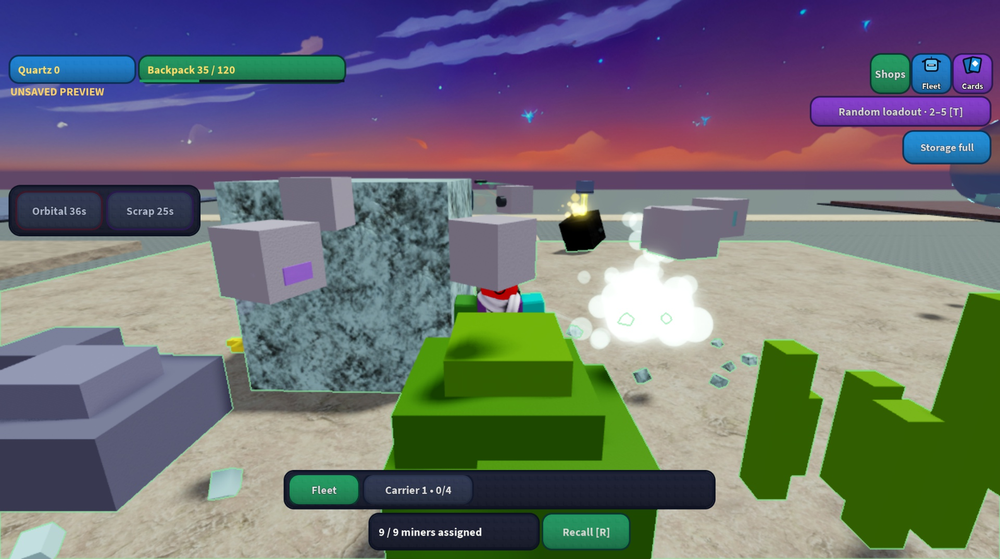

# All-drone testing crew and accurate assignment status

Studio/isolated preview now starts with all seven special miners beside the original eight-role crew: **nine miners and six support drones**. Plot Scanner and maximum **120-unit backpack capacity** are runtime-only modifiers, applied consistently to authoritative stats, actual pickup/fill limits, transport and the published UI. No test cards, shop levels or permanent specialist ownership are inserted. The isolated test profile also has a flying backpack and an empty carrier. Production ownership, capacity and earned automation are unchanged. The Fleet menu's **All drone types** button restores this preset; the optional random 2–5 preset remains.

The old working fraction used the entire living fleet as its denominator while its numerator omitted windup, breaker and recovery phases. The HUD now reads authoritative `CanMine`, `TargetId` and `AutoFieldId`, separates support drones and reports **miners assigned**. That label describes a continuing field order even during travel, charge, recovery or waiting for regrowth; it does not claim every drone is dealing damage in every frame. Recalled, dead, reprinting and other-owner drones cannot invent assignments. Actual specialist and breaker behavior remains distinct from the ordinary cutting laser.

## Native check

The three changed approved Sources were installed in the existing editable Studio place after checking all seven pre-install Source checksums. All seven post-install checks passed. Play was restarted with one permanent drone, 15 active preview drones, nine `CanMine` workers, automatic selection enabled, no saved cards, a 120-unit backpack, flying backpack and one empty carrier.

One ordinary production `Patch` RemoteEvent on Quartz assigned all nine workers. Server observation saw Striker in `Mine`, all seven specialists in `SpecialMine`, and Charger in `BreakerRecover`, with all nine holding distinct real targets and all nine retaining `AutoFieldId=1`. The client production HUD classifier reported nine assigned miners and six support drones. Its actual visible label was `9 / 9 miners assigned`; native text bounds fit the control. Backpack rendered `35 / 120`. Studio output was empty after the check. The screenshot is the running game, not a mock.

## Automated evidence and limits

`python3 tools/test_special_logistics.py /tmp/mining-away-luau` passes the existing domain/server/FX suites plus four preview checks and the production HUD classifier check. Coverage includes all initial types, separate real work reservations for all nine miners, specialist reacquisition after a completed timed job, actual maximum bag filling, stat refresh, purchased identity after reconnect, no test cards/shop upgrades and unchanged production defaults. The retained original-role fixture explicitly isolates its legacy workers from the seven extra specialists for its queue/recovery cases.

`python3 tools/test_gadgets.py /tmp/mining-away-luau` and `python3 tools/test_refinement_client.py /tmp/mining-away-luau` pass. API doubles are not visual or multiplayer evidence. `python3 tests/live-build.spec.py` verifies the deterministic Source-only active-capture build and preservation of every other chunk/backup. `python3 tools/release.py` records the exact commit and checksums in `build/revision.json`.

Native evidence is one desktop player and one field order, including real replicated work states and readable HUD. It does not establish full choreography approval, multi-player behavior, streaming/mobile/graphics variants, real DataStore restart behavior or fun. Studio remains in Play with the test crew mining Quartz. No Roblox publication, new experience or main merge.
