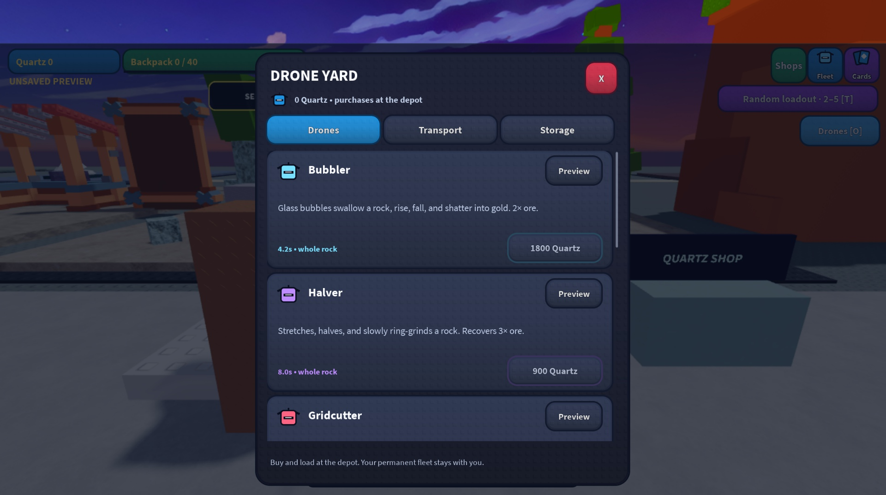

# Cloud commit installed into the existing game

Cloud source `874b60481a3bda67fa772445baf4292e731f14ed` was cherry-picked onto `codex/restore-feel-prestige` as `14fc896`, after preserving the latest reduced-glow work in `33153d4`. These commits retain the original map, assets, physical cards, audio and existing roles. The added systems are the seven special miners, four-bay carriers, flying backpack and launchable typed-mineral storage described in [the feature review](SPECIAL_DRONES_LOGISTICS.md).

## Installation and native evidence

The existing connected Studio file was `build/Drone Blower revolution - editable workspace.rbxl`. Its seven allowlisted Sources matched the pre-integration working source. Studio was stopped, four changed scripts were updated through native `multi_edit`, and all seven final Source lengths/checksums were verified. The other 39 script Sources and script enablement settings were preserved. No HTTP setting was changed: automatic approval review rejected the HTTP installer, so the native script tools completed the installation.

The editable file was saved through Studio's Save command, with the local saved-path notification visible, and Play restarted. The running server reports schema 7, the expected isolated preview profile, one permanent drone, the original eight-role temporary crew, 120-unit storage and the new personal storage building. The game output was empty after startup and the first mining smoke check.

The Drone yard opened through actual pointer input and rendered its specialist cards in the existing colorful textured style. Its Bubbler Preview button added a temporary ninth drone without changing permanent ownership. A normal production `AssignSlot` request was accepted; the server published a 4.2-second Bubbler job while the rock still had its original HP. On the later observation the resource had retired and storage contained 16 ore. This is a narrow native smoke check, not an exact reward assertion or approval of the complete choreography. A second probe found no nearby free rock and did not establish additional coverage.

## Logic, preservation and review

- All 53 current-feature checks pass: 10 domain, 16 bundled-server, 2 preview ownership/reconnect and 25 FX lifecycle checks; all source and both real bundles compile.
- Focused client refinement, energy, audio, gadgets/roles, mining flight and shops runners pass on the combined source. The five production pickup-trajectory cases pass directly with `luau tests/pickup-motion.spec.lua`; this checkout has no `tools/test_pickup_motion.py` runner.
- `python3 tests/live-build.spec.py` passes deterministic output, the exact seven Source allowlist and byte-identical preservation of all other base chunks and backup Sources. The release uses `assets/drone-blower-revolution-base.rbxl`, never the historical Mining Away base.
- Behavior/parity review: ordinary flight/mining remains unchanged by the feature; specialists use authoritative timed whole-rock work; purchased identity, carrier loadouts and safe persistence retain the existing profile/transaction boundary. Reduced-glow edits are included in both server and client bundles.
- Pacing/visual/multiplayer review: timed specialist cycles, 120-ore launches, overflow retention and carrier continuation have automated coverage. Actual desktop startup/menu and one temporary Bubbler order were inspected. Full carrier/backpack/launch play loops, all seven native effect choreographies, mobile/graphics variants, busy multiplayer/streaming, real DataStore restarts, sound balance and enjoyment remain **NOT VERIFIED**.

Reproduce the primary review build with `python3 tools/release.py`. `build/revision.json` records the exact final commit and place checksums. The editable copy preserves the existing native map; the primary review place changes only approved Sources in the verified live capture. Studio is left in Play. No Roblox publication, new experience or main merge occurred.
