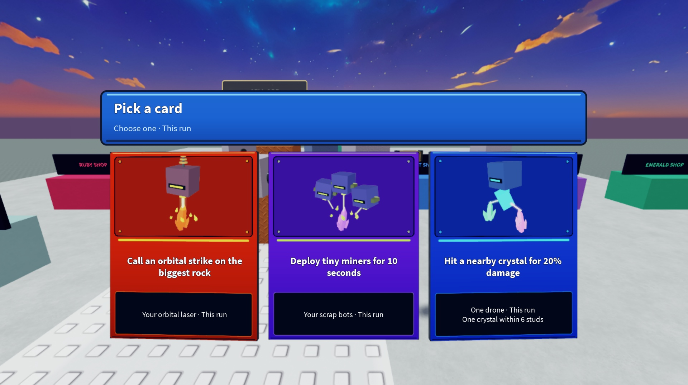
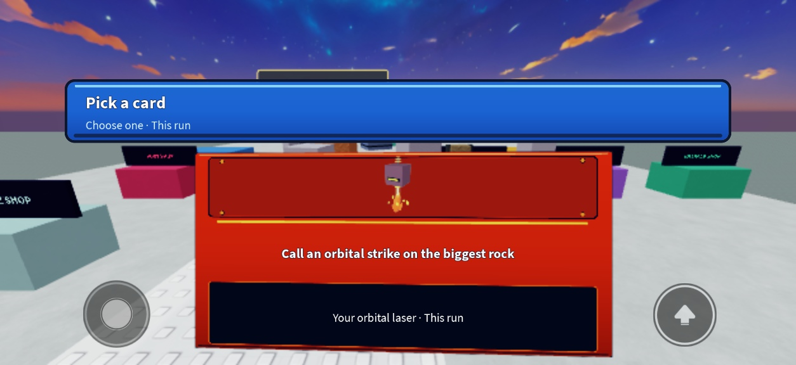

# Colorful pack reference and native card review

November 2, 2026. Follow-up to cloud candidate `f5a9fde`. The owner rejected the first follow-up preview. The broad stripes and miniature generic instrument scenes from that iteration are removed.

## Images actually inspected

Opened the actual screenshots linked from [Pro Game Guides' Catch a Brainrot guide](https://progameguides.com/roblox/catch-a-brainrot-beginners-guide/), rather than relying on search descriptions:

- [Player progression panel](https://progameguides.com/wp-content/uploads/2026/07/Catch-A-Brainrot-Farming-PlayerXP.jpg?resize=1200%2C675): blue housing, dark borders, inset progress tracks, and a distinct purple reward row.
- [Trading menu](https://progameguides.com/wp-content/uploads/2026/07/Catch-A-Brainrot-Trading-Brainrots.jpg?resize=1200%2C675): blue outer frame, deep outlines, purple/gold controls, light upper edges and darker lower edges.
- [Starter choice](https://progameguides.com/wp-content/uploads/2026/07/Catch-A-Brainrot-Starter.jpg?resize=1200%2C675): recognizable models and physical display stands carry the choice, with a brief outlined heading.
- [Battle introduction](https://progameguides.com/wp-content/uploads/2026/07/Catch-A-Brainrot-Farming-EXP.jpg?resize=1200%2C675): a clear subject and a contrasting, bounded dialogue surface.

These are observations of still images, not a completed video/motion study. Our opening/focus timings and instrument scenes are original implementation choices. No artwork, branding, font files or texture assets were copied into the game.

## Applied presentation

The existing camera-local physical card and SurfaceGui/ViewportFrame artwork remain. The seven live Source allowlist and captured game/map remain the integration boundary.

Cards now use the original drone and crystal templates, actual role hardware, visible optics and distinct working scenes: orbital contact, three scrap miners, split crystals, courier parcels, repair, thrust, planting, impact and cutting. Card-only hardware is separated from the cubic shell so it can be seen; the original world models are unchanged. Drone/crystal framing is normalized to an explicit illustration size instead of the former arbitrary tiny template scale.

The nine mechanic colors remain distinct. Molded upper/lower edges, small fasteners, inset artwork and terms give the panels depth. The pack purchase view gets an original sealed wrapper, brighter blue housing and a violet action. The desktop offer row is limited to an 820-pixel panel. Short safe viewports use a smaller header, a shorter artwork region and more space for benefits/terms; text stays at least 18/16 pixels. Cards still contain exactly two text labels and preserve server-generated choices, targets, tradeoffs and this-run terms.

A brief opening glint, focus sparks, art-camera shift, physical lift and press response provide feedback. The effects stop after their response interval; there is no perpetual screen-wide particle effect. System reduced motion, both existing player attributes and the explicit harness override suppress sweeps/sparks and tilt/lift. Selection still uses ordinary screen-space touch/controller hitboxes. No reward, rarity, paid choice or selection contract changed.

## Native defects found and repaired

In this Studio renderer, `AlwaysOnTop=true` hid complete SurfaceGui faces, including a minimal diagnostic label with no ViewportFrame. Parenting, face direction and distance changes did not restore them. The depth pass did. The production cards now use that pass at one stud from the camera, with a thin body and bounded distance. This is measured behavior in the current renderer, not a claim about every Roblox renderer. Close-world occlusion and wider low/high-graphics coverage still need final acceptance.

Native phone screenshots then exposed missing/aliased glyph rows in the near-camera surface pass, despite passing TextFits metrics. The two labels now render in the native screen layer over the same physical card, following its lift and ordinary scrolling/clipping. The artwork and housing retain real 3D perspective. Final screenshots show the crisp labels. This fix would not have been established by API doubles or compilation.

## Evidence and reproduction

These are **actual Studio captures of the production CardView and real catalog in a presentation harness**. The harness suppresses the unrelated gameplay HUD, supplies sample choices, and neither buys nor grants cards. It is not a real pack transaction, gameplay or multiplayer test. It was removed after inspection.

`tools/studio_card_review.lua` documents reproduction: prepend `build.module_bundle(('Shops','DroneRoles','Cards','UILayout','Interface','CardView'))` and execute the result in Studio's Client DataModel. `_G.MiningPackReview.checkAll(width, safeHeight)` measures native labels. `_G.MiningPackReview.destroy()` removes every preview card, connection and GUI and restores the game HUD.

- Actual desktop client viewport: 1167×595. Default viewport restored after device checks.
- Device: dynamically discovered iPhone 17 Pro preset, landscape 750×381 client viewport; compact font checks account for the 315-pixel safe height. The game's orientation is Sensor, and the production/harness ScreenGuis use CoreUISafeInsets.
- All 45 catalog entries / 90 labels fit at desktop 1280×720 and compact 750×315 fixtures after fixing a three-benefit overflow. Catalog fixtures do not prove every future saved/custom target string fits.
- Native selection focus produced four short-lived sparks. The player reduced-motion attribute suppressed all glints/sparks in the inspected frame.
- `tools/test_mining_flight.py` passes the existing production-logic checks; production CardView/Client and the native harness compile. These are separate from native screenshots.

No new UI test scripts or review objects enter the release place. The saved native editable artifact receives only allowlisted Source changes; the source-only release is rebuilt from the immutable live capture. No publishing, new experience or main merge.

**Independent visual acceptance, complete opening/selection/confirmation motion, every input mode, low/high graphics, close-world occlusion and busy multiplayer remain NOT VERIFIED.** The revised candidate is for owner review, not a declaration that it matches or exceeds the reference game's production quality.
