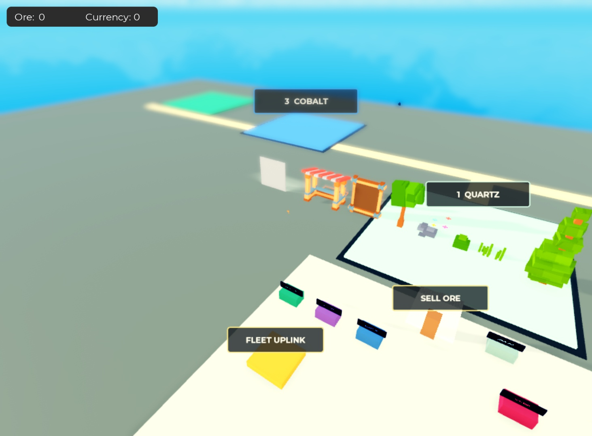

# Apply the map to editable Workspace

November 1, 2026. The owner’s screenshot showed the unchanged Edit-mode map. Previous deliveries updated controller Source and generated the layout only when Play started. That did not meet the owner’s expectation that the changes exist in editable Workspace.

Applied directly in the existing Drone Blower revolution Studio instance, in **Edit mode**, with before/after Undo waypoints:

- Moved the original field assemblies into progression order and placed Quartz centrally at `(-56, 0.5, 65)`.
- Moved the actual SpawnLocation to `(-56, 1.5, 23)`, ten studs before Quartz’s entrance, facing it. Quartz is the closest field.
- Added all five named shop counters, with Quartz’s shop at `(-72, 2.5, 21)` beside spawn, and the short paved approach.
- Set consistent field IDs and retained the depot origin, original models, terrain, machines and archived scripts.

The same production layout functions now support runtime startup and a generated Edit-mode application script. Replaying that script in the actual editor produced the same field, spawn and shop coordinates, without duplicate counters or repeated tier offsets. No Play session was started and nothing was published. Edit-time geometry evidence does not establish gameplay/multiplayer acceptance.



## Saved copy and reproduction

The full native map was saved through Studio’s **File → Download a Copy** to `build/Drone Blower revolution - editable workspace.rbxl`. This is an artifact of the same game, not another experience. Open this copy to inspect the map without Play.

The original `assets/drone-blower-revolution-base.rbxl` remains untouched. `build/Drone Blower revolution.rbxl` remains the separate source-only binary-preservation build; its unchanged geometry is intentional for that artifact and must not be presented as the baked editor copy.

To reproduce the editable layout from the source-only capture:

```sh
python3 tools/build.py --editor-layout-script build/apply-editable-workspace.lua
```

Open the source-only build in Studio **Edit mode**, execute that generated script through the Command Bar or Studio MCP, and use File → Download a Copy. It checks the expected map and place identity and never starts gameplay. The local release ZIP includes the script and, when present, the native editable export. Release refuses a stale native copy whose live Sources do not match the current source revision, and verifies every original backup Source. Two additional existing permanent-plot backup scripts in ServerStorage are retained and recorded.

Before-edit geometry is retained in `build/workspace-before-edit-layout-20261101.json`. Actual before/after and replay results are in [EDIT_WORKSPACE_RESULT.json](EDIT_WORKSPACE_RESULT.json). Source/domain/API-double checks remain separate from the actual Edit-mode screenshot and layout verification.

The focused suite passes 102 production-domain/API-double checks. The new regression verifies field identity/IDs and that replaying a baked layout does not shift fields again. Generated server, client and Edit-layout scripts compile. Native scene visibility was checked separately in the actual Edit viewport.
