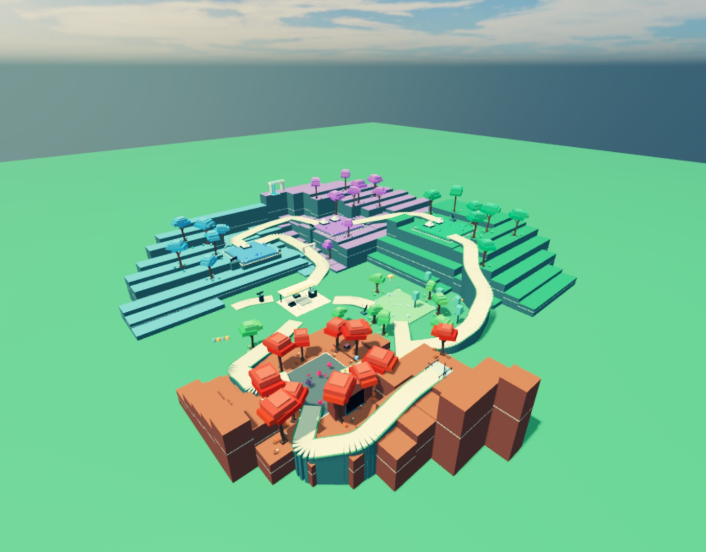
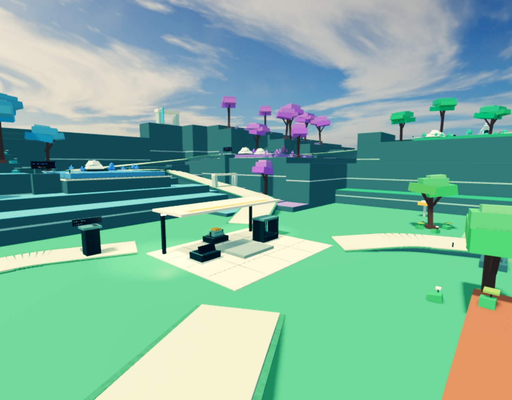
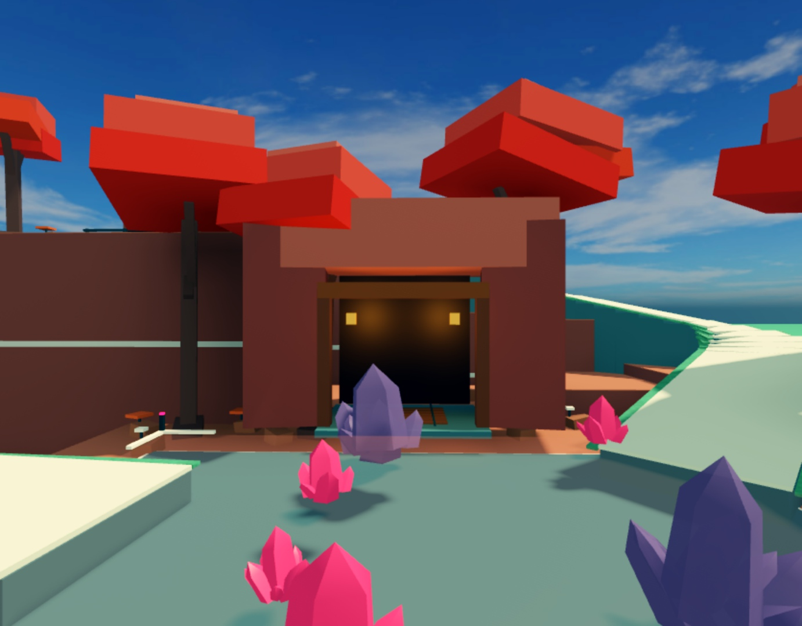

# Expanded valley and sparse hub

October 25, 2026. The owner approved the denser terrain direction, then asked for a much larger map, a sparse middle hub, and fields before the outer hills/forests. This revision takes precedence over the earlier compact layout.

## Final behavior

The landscape is 1.9× wider and deeper than the compact revision, with about 3.6× the planning area. Fields are 1.4× wider/deeper. A protected ground-level meadow around the original depot has 50/46-stud half-widths and excludes new trees/canopies. Wooded cliffs sit farther out. The nine connected routes and the original mineral colors, trees, crystal/drone models, Converter and segmented construct remain. Further decorative work is deferred.

`MapLayout.lua` expands the landscape separately from field-local grove/landmark clusters. Original parts-built assemblies retain their internal proportions. `Config.lua` stores the actual field positions/sizes. `World.lua` emits the complete server-owned map. The current map reference documents exact coordinates and tooling.

## Review 1: gameplay and parity

The map changes do not alter the economy, rewards, card outcomes, persistent drone identities, prestige resets, encounter rosters, mining/fracture timing or eased/capped flight helper. Field IDs and strengths are stable. The expanded Cobalt field is now outside command range from spawn; the assault-UI integration test was corrected to place its fixture near Cobalt before issuing a command, preserving production range validation.

The representative flight test checks terrain clearance between home and field-center overhead stations. It is not proof for every random crystal/fleet/canopy configuration. Original asset/binary preservation is verified separately. Concurrent UI and sentry source commits are preserved in the combined build; their native checks are documented in their own reviews.

## Review 2: scale, traversal, visuals and shared world

The enlarged map was installed into the existing Studio review place using complete current server/client bundles. The views show open ground around home, wider field clearings, and the same colored cliffs/groves farther away. The first avatar pass walked eight routes successfully and found the Grove approach touching the Ruby portal rock. That approach now enters from the east, with a gentler bend; its real-avatar rerun passed. A new pure geometry check prevents road strips folding above their own walking lane.

The final map runs once on the server; clients receive the replicated world. This was inspected in one Studio client, not a true two-client/late-join session. The canonical `.rbxl` remains generated from the original asset; nothing was published to Roblox.

## Executed checks

- Full source compilation, pure gameplay/map checks, production-server tests with API doubles, standalone host-bound lint, and binary/original-geometry tests pass. `EXPANDED_MAP_TEST_RESULTS.txt` preserves exact output. There are 12 map checks and 39 production-server/API-double integrations; API doubles are not engine evidence.
- Real Studio: **3,120 final sampling positions** across all nine routes, with floor rays and body-volume overlap checks, zero issues. Walk surfaces are excluded from body boxes because pitched-floor intersections are handled by the floor probes.
- Real Studio avatar: eight routes passed in the first expanded-map installation; the repaired Grove route passed in the final installation, without jumping or teleports between its chords. Route starts were separately staged. The successful coverage spans 219 route segments; it is not one uninterrupted whole-map walk.
- `EXPANDED_MAP_STUDIO.json` retains the initial failure, final Grove pass and final collision result. The temporary walker was removed, the avatar returned home, and the original GUI flags/camera were restored.
- Final point-in-time Studio console output was empty. This is not an exhaustive error/performance guarantee.

Remaining acceptance: owner review of the larger scale, uninterrupted progression/pacing, two actual clients and late join, network latency, large-fleet performance, live DataStore restart checks, and full original-feel comparison footage. No claim is made that these passed.

Reproduce: `python3 tools/test.py /path/to/luau`; `python3 tests/binary.spec.py`; `python3 tests/geometry.spec.py`; `python3 tools/release.py`. Open `build/Mining Away.rbxl` and press Play. `build/revision.json` records the exact source commit and place hash.

