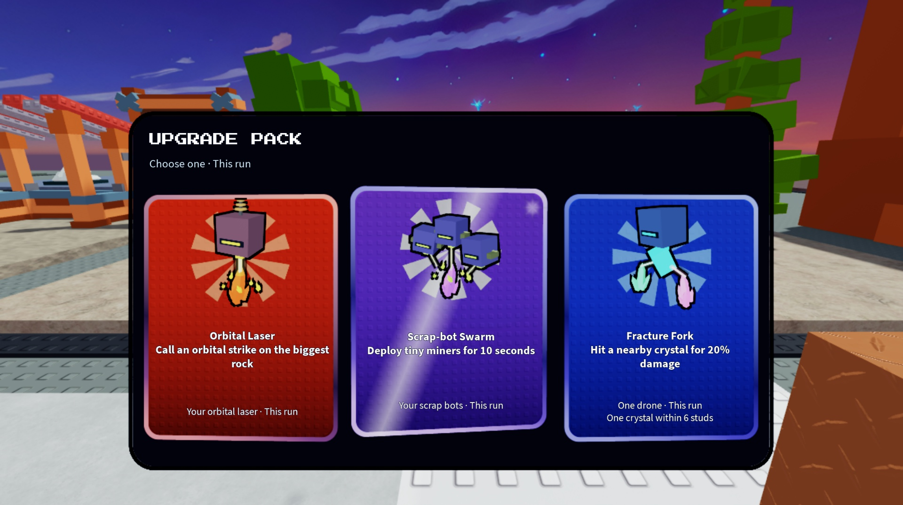
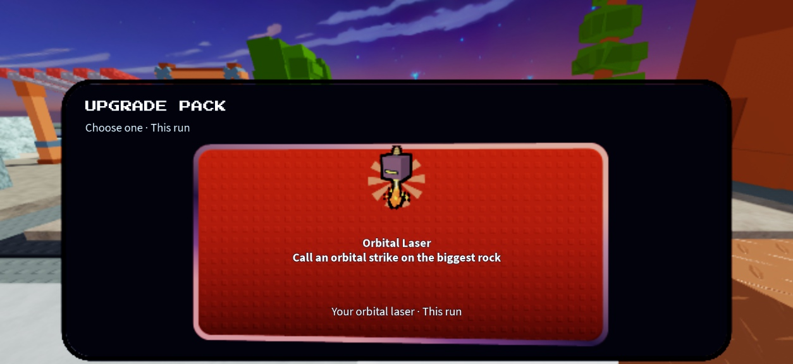

# Glossy interactive pack cards — November 2

The owner-supplied egg-window screenshot is the visual reference: a single dark rounded backing, bright studded cards, outlined 3D objects, spinning rays, broad gradient bevels, specular sweeps and mouse-following light. The artwork remains the original game's drone and crystal models. The two text groups now contain the actual upgrade title/benefit and its target, duration and tradeoffs. Saved server offers and selection remain authoritative.

The physical cards tilt in pitch/yaw with the pointer; the model camera shifts slightly too. Focus raises the card and triggers a diagonal light sweep and corner flash. A soft highlight tracks pointer position. Ten native wedge rays rotate behind each object; four offset black ViewportFrame renders outline the actual model silhouette. The gradient bevel is a rounded native frame, so it renders consistently in the camera-local SurfaceGui. Text and input remain native screen UI for legibility. A deeper physical backing avoids an opaque ScreenGui covering the 3D cards. Closing/destroying cards removes their render bindings, models and surfaces. Reduced motion keeps rays, perspective and lights static while retaining focus contrast. Native touch controls hide while a modal is open and restore their previous state on close.

## Native Studio evidence

The screenshots below use the production CardView/Cards modules in `tools/studio_card_review.lua`, sample catalog choices G01/G02/D10, and a dark backing with the same production geometry. They are a native presentation harness, not a purchase or multiplayer playtest. Production includes its ordinary close button and header icon.

- Native TextFits: all 45 catalog choices / 90 labels pass at desktop, 750×315 safe test dimensions, and a 390-pixel portrait-width layout. A four-line Courier Network overflow discovered during review was fixed by increasing the compact effect text area.
- Actual mouse movement: center card highlight changes from centered to x=.6925 / y=.2601; unfocused cards remain transparent. Its physical yaw/pitch and model camera change with pointer location.
- Rays measured at distinct rotations across successive native captures. Reduced-motion check reports static rays, no sweep and no pointer glow.
- Harness destroy leaves zero LocalUpgradeCard folders, zero physical backdrops and zero card/backdrop SurfaceGuis.
- The installed production client starts with its normal HUD and no console errors. The actual pack purchase menu opens through Cards → View next pack; all eight text labels fit. No purchase or reward was triggered. Fixed its per-frame subtitle color so the dark panel retains contrast.
- Device simulator restored to the default viewport. Studio Edit saved the installed production ClientDroneControl.

## Reproduction and limits

Run `python3 tools/test_mining_flight.py /private/tmp/mining-away-luau` and `python3 tools/test_shops.py /private/tmp/mining-away-luau`. These exercise real production logic through API doubles and compile source/bundles; they do not establish gameplay feel or multiplayer visual quality. `python3 tools/release.py` produces the exact clean-commit release and validates all seven allowlisted script Sources plus preserved backup scripts/chunks. The exact revision and build hashes are in `build/revision.json`.

No Roblox publishing or main merge. Independent final art approval and busy multiplayer / low-high graphics performance remain unverified. The full game visual gate remains NOT VERIFIED; these images establish this UI iteration only.
