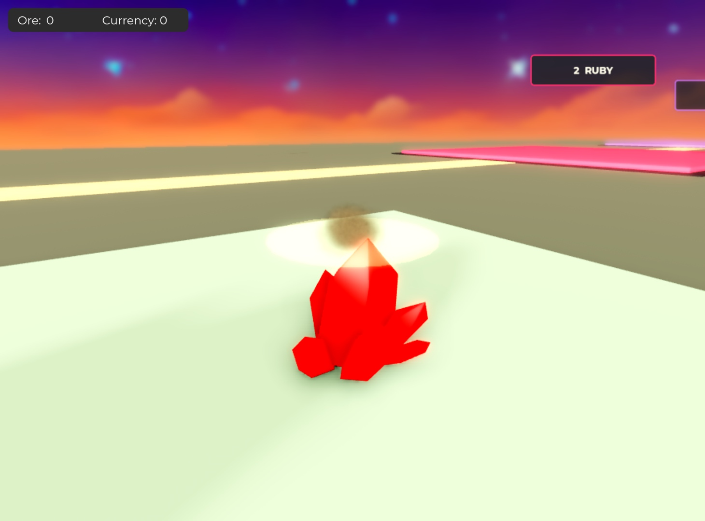
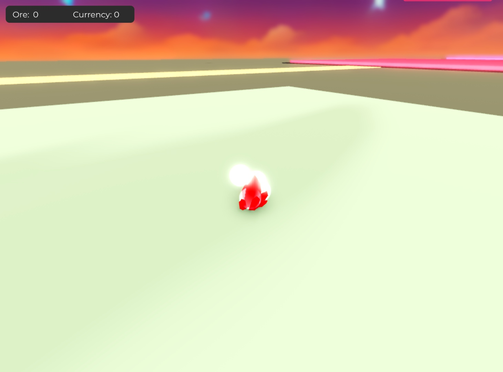
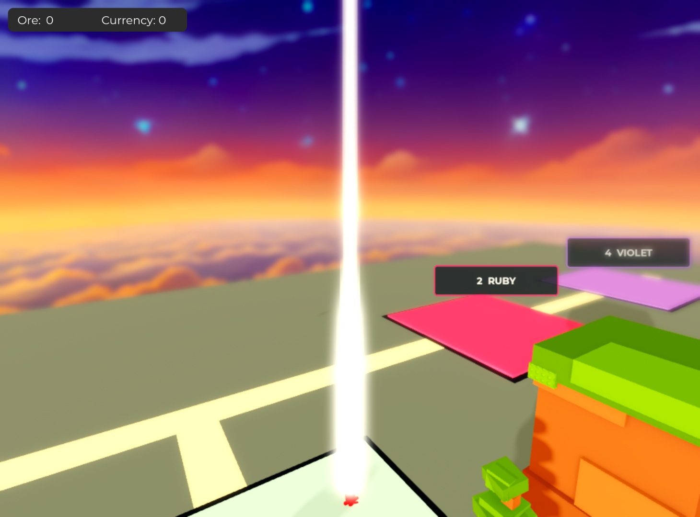
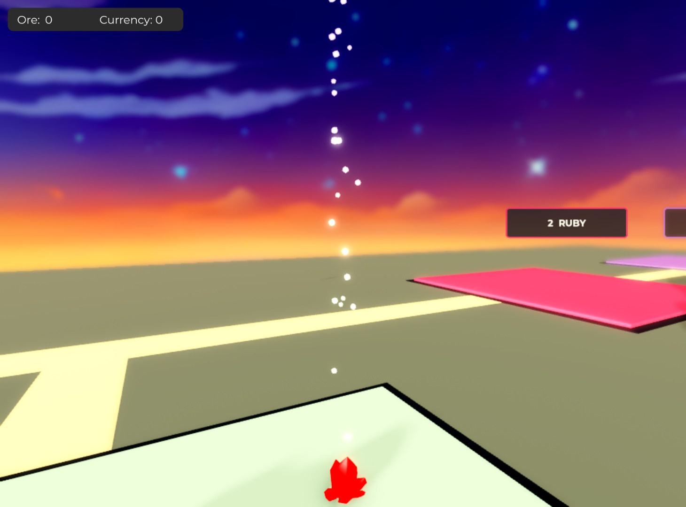

# Smaller particles, smoke fractures and layered orbital

November 3, 2026. Latest owner direction supersedes the earlier all-circle treatment. Same Drone Blower revolution project; no publishing or Play startup.

Common work energy now peaks around 0.26 stud instead of 0.65. Cutting sparks peak at 0.22 instead of 0.55, utility bursts at 0.36 instead of 1.05, and pickup glints at 0.20 instead of 0.45. The preserved circle remains for neutral energy; built-in sparkle marks, stretched sparks, irregular smoke and the original crystal fragments distinguish jobs. Glow spheres and authored meshes remain intact.

Ordinary stage/break events now call a separate matte gray-brown smoke burst, lightly tinted by the mineral. It has 6/14 puffs, slow local rise, random rotation, no additive glow and a bounded tail. Breaker impact also uses smoke. Currency still has its own small bright glints. Completed specialist jobs retain the integration pass's suppression of duplicate ordinary fracture showers.

Work, pickup, grower, breaker, swarm and orbital particles explicitly reject global wind. Shared sideways noise acceleration was removed; random launch directions provide modest local variation. The world wind and unrelated original assets are unchanged.

Orbital retains its replicated physical core/halo alongside the client Beam. The Beam grows from 1.8 to 3.2 studs wide and uses two broad moving white/clear bands instead of three. At shutdown, a fixed 260-stud cylindrical volume emits 312 small motes with near-zero speed. One emitter replaces twelve sparse attachment bursts. The carrier does not shrink with the laser, remains for the full 4-second maximum particle tail, and is cleaned after 4.4 seconds. Rate is zero so it cannot continue accumulating particles.

Implementation follows Roblox's [particle emitter documentation](https://create.roblox.com/docs/effects/particle-emitters): Cylinder + Volume is parented to a BasePart, and WindAffectsDrag is disabled for localized effects. The rotated cylinder's local X/Right axis follows the vertical column.

## Verification

- `python3 tools/test_energy_effects.py /private/tmp/mining-away-luau`: 8 production logic checks pass, covering ordered ramp at 30/60/144 FPS, full tails, bounded pools, physical-source visibility, volumetric residue, smoke dispatch and preserved authored fragments.
- `python3 tools/test_refinement_client.py /private/tmp/mining-away-luau`: client motion, commands and contact cue regressions pass.
- `python3 tools/test_gadgets.py /private/tmp/mining-away-luau`: domain, contact renderer, authoritative roles, pickups and server regressions pass. The contact texture assertion now reflects the requested non-circular sparks.

These are API-double checks, not visual or multiplayer evidence. Native Edit-mode previews are below. Combined implementation revision: `70c5986eb6d7c428d2723f5048bcb2627c3a3188`, including particle commit `0babff51afb486861f14225c9e910ef478e8312d`. Primary source-only place SHA-256: `db26082bff3fdbdf7c74c69e5252478aaf14045f48999e11f12a348fe0d679c7`. Final package metadata is in `build/revision.json`.

## Native screenshots

These are unedited Roblox Studio captures from an isolated **Edit-mode effect preview**, using the exact new production WorkEffects and DroneRoleEffects modules and the PickupView sparkle helper. Original crystal geometry provides scale; the preview does not execute gameplay, show the running fleet, or validate multiplayer. The saved editable map/lighting remains visible. Particle samples were frozen with TimeScale=0 only on temporary preview emitters so the images can be compared. This override is absent from production.

Smoke, sparkles and circle textures each returned `Enum.AssetFetchStatus.Success` from native ContentProvider. The residual emitter reported Cylinder/Volume, size `(260, 2.25, 2.25)`, local Right axis approximately `(0, 1, 0)`, and 312 emitted particles. The active core reported LocalTransparencyModifier 0 and Transparency 0.6 alongside a 3.2-stud Beam. The screenshots show the physical center remains visible between the wider Beam bands and the residual dots occupy the vertical column. They do not establish timing in live gameplay.

| Cutting sparks | Rock fracture smoke |
| --- | --- |
|  |  |
| Breaker pressure/dust | Pickup collection glints |
|  |  |
| Physical orbital plus wider Beam | Residual vertical particle volume |
|  |  |

Preview reproduction: in a stopped local copy, load the production modules into temporary ModuleScripts; call WorkEffects:mining/fracture, DroneRoleEffects.BreakerPhase/Ability, and the extracted unmodified PickupView sparkle helper on temporary original-crystal clones. Emit representative samples, allow 0.2–0.3 seconds for separation, freeze temporary particles, and use native screen_capture with an explicit camera. The orbital screenshot fixes a real transparency-ramp sample at phase zero; its afterglow is a clone of the actual shutdown carrier. Remove the temporary modules, geometry, emitters and added bloom, and restore the camera. Never save preview objects into the game.

The first attempted FastForward call was rejected by Studio capability checks; it was replaced by ordinary elapsed time followed by a temporary TimeScale freeze. No permissions were changed. During the last pickup/cleanup step Studio unexpectedly transitioned to Play, causing two Edit calls to fail. This chat never called start_stop_play(true). That failed screenshot was discarded; start_stop_play(false) restored Edit, then the valid pickup capture and cleanup completed. Final native cleanup reported `running=false`, `previewObjects=false`, `previewModules=false`, `addedBloom=false`. The integration chat then received native install/save ownership. Full gameplay motion, low/high graphics and busy multiplayer remain unverified.
