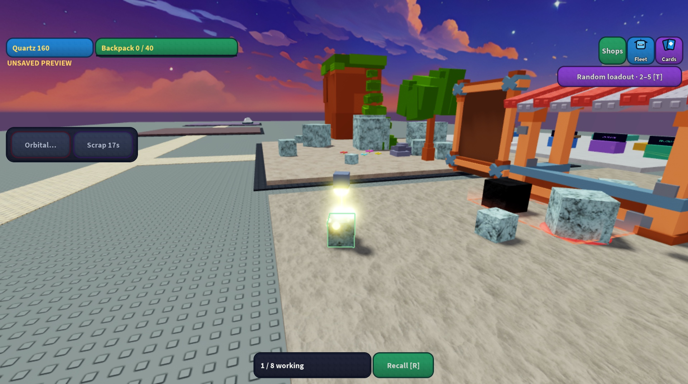
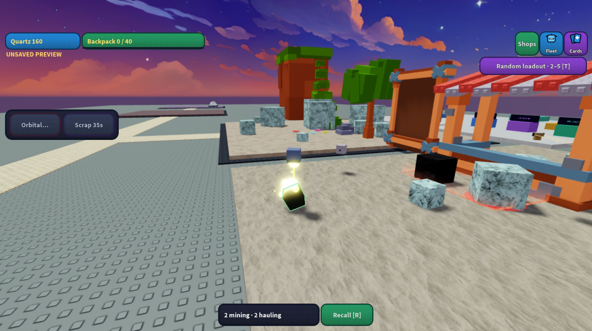
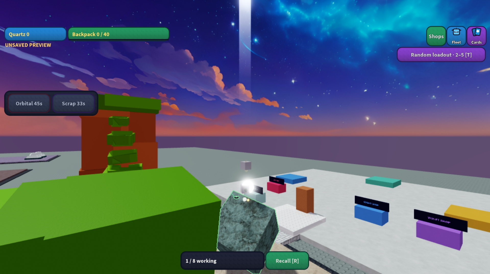

# Localized particle tuning and native review

November 3, 2026. Same Drone Blower revolution game, place 136098934779395, branch `codex/restore-feel-prestige`. Exact integrated source and place hashes are stamped in `build/revision.json` by the clean release command. No Roblox publication or main merge.

The owner asked for longer particles, then corrected the first pass: they should persist moderately longer and travel less in most cases. The excessive initial 2–7 second tuning was discarded. Ordinary cutting discs now live **0.85–1.35 seconds**, start at **2–4 studs/second**, and use drag 2.4 with reduced gravity and turbulence. Peak size is 0.55 stud, Brightness 4, and ordinary emission is 12 per second. This keeps the glowing circles close to the contact without piling up a white cloud. Break/smasher/grower energy lasts 1–1.6 seconds with low speeds; tiny swarm chips stay at 0.25–0.5 seconds. Pickup glints last 0.65–1.1 seconds and move at 0.1–0.4 studs/second. Actual mineral expiry remains 18 seconds.

The orbital retains the longer signature: active discs last 2–3.5 seconds, cooling motes 2.5–4 seconds, with lower speed and turbulence than the rejected pass. A separate image review caught contact glare hiding the rock top. Its overlapping contact sparks were reduced to 10 per second, Brightness 2 and a softer transparency envelope, with a smaller translucent core; larger column discs and bloom remain. Its fast downward white/clear beam and camera-relative height remain. Particle parents outlive their longest tail. Target changes, swarm expiry and collection stop new emission immediately while already-emitted world-space particles finish naturally; full controller cleanup removes their parents. The orbital watchdog measures stale contacts instead of truncating a resumed strike at a fixed time after creation.

## Native evidence

The final ordinary emitter was observed during a real accepted Striker assignment: Lifetime 0.85–1.35, Speed 2–4, Rate 12, Brightness 4. Native ContentProvider fetching returned `AssetFetchStatus.Success` for `rbxasset://textures/ui/VR/circleWhite.png`. Fresh full-speed emitters and local `MiningEnergyBloom` render visibly in the existing map. The screenshots below are direct Studio captures, without image editing. The second uses the same camera with the added bloom disabled for diagnosis; gameplay continued between captures, so particle positions and rock stage differ. Bloom was restored afterward.





During the orbital review, the actual largest Quartz rock was blocked from above by `Workspace.Stud pack V1.Tree1.Part`. The old selector kept choosing it, failing the authoritative ray check, refunding the cooldown and charging again indefinitely. Orbital target selection now filters using that same authoritative ray path, choosing the largest reachable rock and leaving Scrap target rules intact. Damage still rejects obstructions. This finding came from native gameplay inspection, not a particle-property check.

After installing the corrected final Sources and restarting Play, a real Quartz order produced a sustained orbital burn and a 45-second cooldown. Native inspection reported `MeltCore.LocalTransparencyModifier = 1` and `MeltHalo.LocalTransparencyModifier = 1` while the custom white/clear beam rendered, with contact Transparency 0.55 and spark Rate 10. The screenshot captures a clear-band phase between the contact and upper white stripe; one still does not establish motion or clipping across every angle. The final inspected console was empty. Camera control and bloom were restored after the captures.



## Reproduction and limits

Run the focused suites with pinned Luau in `/private/tmp/mining-away-luau`:

```sh
python3 tools/test_energy_effects.py /private/tmp/mining-away-luau
python3 tools/test_refinement_client.py /private/tmp/mining-away-luau
python3 tools/test_audio.py /private/tmp/mining-away-luau
python3 tools/test_gadgets.py /private/tmp/mining-away-luau
python3 tools/test_shops.py /private/tmp/mining-away-luau
python3 tools/release.py
```

Seven production energy/fragment checks exercise ramp ordering, fresh emitters, distance behavior, complete tails, bounded cleanup, camera height, reduced motion and authored fragments. Gadget/server tests cover actual authority and target selection. The shop/build suite checks persistence and deterministic preservation: only the exact seven live Sources may differ from the captured release base, with all other chunks and backup Sources preserved. These automated checks use API doubles and are separate from the native screenshots.

Native Edit installation verifies exact previous/current Sources and all 39 unrelated scripts. The latest saved editable file is refreshed offline from its exact previously installed native Source hashes, preserving its map and all non-Source chunks/backups. Native UI Save was available earlier, but macOS later locked; it was not bypassed. The dedicated Studio connector provides the runtime installation/captures. This distinction is recorded so an offline save is not misreported as a native Save.

This pass establishes native texture loading and visible localized energy in a one-player desktop session. Busy two-player/late-join appearance, phone input, low/high graphics comparison, real DataStore restart and subjective satisfaction remain unverified. It does not claim the broader independent visual gate has passed. Historical broad fixtures with older typography/schema/formation assumptions are not claimed green.
