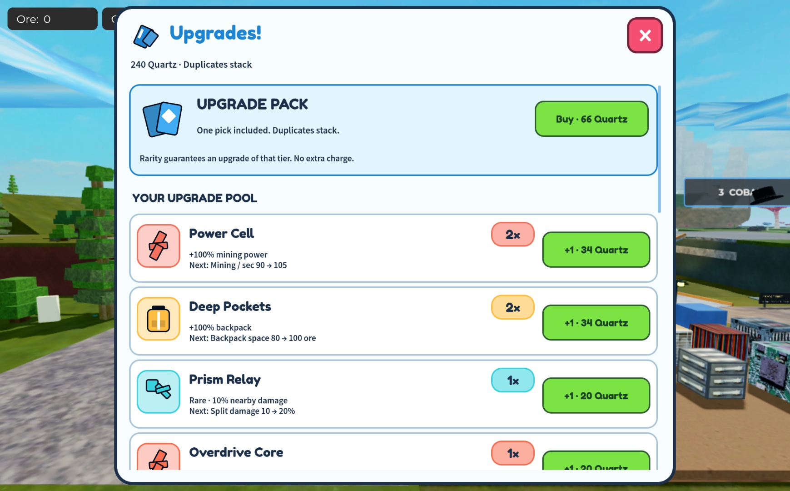
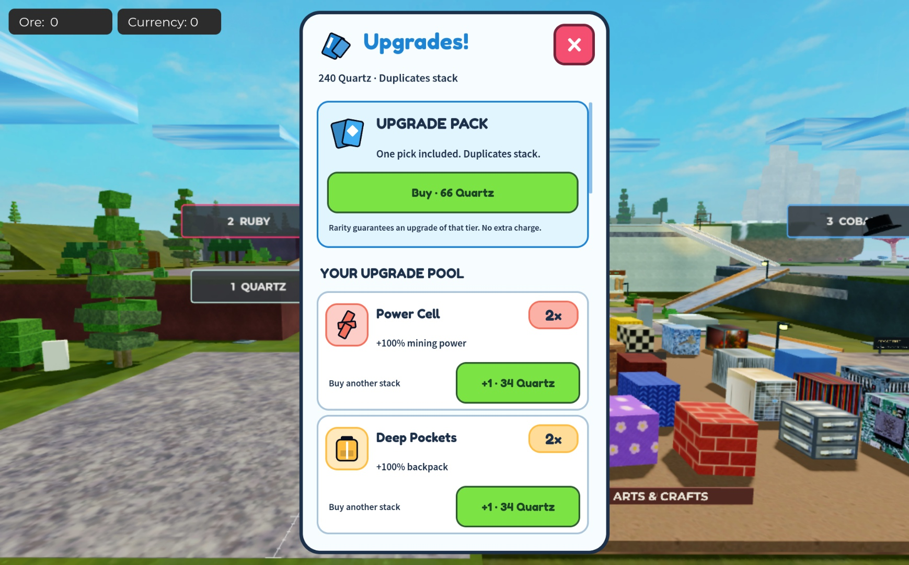

# Quartz upgrade pool — November 8, 2026

The pack purchase includes one of three saved upgrade choices. A Legendary result always contains at least one useful Legendary upgrade, which remains claimable with zero Quartz left, including after reconnecting. New picks always grant one copy; repeated picks merge into a single 2×/3× row. There is no overall three-upgrade ownership limit. Direct purchases of another owned copy keep Leaf Blower-style increasing costs.

## Economy and choices

| Action | Quartz cost or result |
| --- | --- |
| Buy packs in a run | 20, 27, 36, 49, 66, 90…; rounded `20 × 1.35^packIndex` |
| Select a paid pack choice | Included; no extra charge, any of the three choices |
| Buy another owned copy | 20, 34, 58, 98, 167…; rounded `20 × 1.7^(count−1)` |
| First prestige | 360 Quartz sold; spending does not subtract progress |
| Prestige reward | One permanent mining worker and +25% base mining power; exact existing fleet retained |
| Prestige reset | Run upgrades, stacks, currency and pack prices |

Pack rarity rolls with the existing 66/24/8/2 relative Common/Rare/Epic/Legendary weights when all tiers are eligible. Choices come from that tier and below, with at least one exact-tier upgrade. Fully stacked or ineffective upgrades leave the pool. A tier leaves the rarity roll if it cannot supply a valid triple. No charge occurs if no valid triple remains. These conditions can change effective odds late in a run.

The generator compares actual clamped effects across the permanent fleet and backpack. It excludes triples where an option is entirely matched or beaten by another option, so Overdrive is not offered beside an inferior Power Cell. It chooses a seeded weighted triple and saves the complete result before disclosure; closing or reconnecting does not reroll. Future direct-copy opportunities still depend on the chosen build, so mechanical filtering is not proof of equally attractive choices.

| Tier | Upgrade | Effect of one copy |
| --- | --- | --- |
| Common | Power Cell | +50% mining power |
| Common | Quick Ignition | +100% startup rate |
| Common | Deep Pockets | +50% backpack |
| Common | Thrusters | +40% flight speed |
| Rare | Quartz Polisher | +25% ore yield |
| Rare | Route Runner | +40% flight speed; automatic nearby retargeting |
| Rare | Prism Relay | 10% nearby mining damage |
| Epic | Hot Start | +25% mining power, +200% startup rate |
| Epic | Cargo Loop | +50% backpack, +12.5% ore yield |
| Epic | Prism Drive | 10% nearby damage, +30% flight speed |
| Legendary | Overdrive Core | +100% mining power, +200% startup rate |
| Legendary | Prismatic Core | 20% nearby damage, +25% ore yield |
| Legendary | Autonomous Fleet | +75% flight speed, +50% backpack, automatic retargeting |

Percentages add to base traits, subject to existing effective caps and per-upgrade copy limits. Automatic targeting and split reach unlock once, rather than multiplying on repeat picks. Existing paid legacy offers retain their already-promised effects. Profile schema 10 migrates schema 9 without resetting ownership, run modifiers, receipts or paid offers.

## References and presentation

Inspected the actual [n-gon source](https://github.com/landgreen/n-gon), especially [powerup.js](https://raw.githubusercontent.com/landgreen/n-gon/master/js/powerup.js) and [tech.js](https://raw.githubusercontent.com/landgreen/n-gon/master/js/tech.js): eligible random offers, per-tech copy limits and accumulated tech counts informed the pool. Repeat investment follows the upgrade-driven idle progression described by [Leaf Blower Revolution](https://store.steampowered.com/app/1468260/Leaf_Blower_Revolution__Idle_Game/).

Inspected real upgrade-screen images in BIG Games' [Pet Simulator 99 Update 48](https://www.biggames.io/post/pet-simulator-99-update-48) and [Update 51](https://www.biggames.io/post/pet-simulator-99-update-51). The new native shop uses a light rounded panel, dark outlines, colorful mechanic icons, prominent stack badges and green price buttons. It retains this game's physical card opening and tactical HUD. No external artwork was copied.

Actual Interface/ShopView components were mounted temporarily under StarterGui in Studio **Edit**, with a fixture profile, at 740×629 and 351×620. Both screenshots were visually inspected; all labels/buttons fit. The preview was removed afterward. These are static native component previews, not a running shop or touch-device playtest.

## Verification and remaining questions

Reproduce with `python3 tools/test_workshop.py /path/to/luau-tools`. All source files and both bundles compile. Changed logic analysis passes. Twelve workshop groups include 150 seeded eight-pack sequences, more than three owned upgrades, each rarity's duplicate behavior, zero-wallet Legendary claims after reconnect, immutable paid choices, increasing repeat prices, capped-effect rejection, migration and twelve prestige rewards. Six mining checks, 28 persistence checks, and five actual production-server checks in each of production and Studio configurations pass using API doubles. See [captured output](quartz-pool-tests.txt).

Actual production worker logic measured the same rock after arrival:

| Build | Seconds to finish |
| --- | ---: |
| Base | 8.867 |
| Power Cell 1× | 6.983 |
| Power Cell 2× | 6.050 |
| Quick Ignition 1× | 7.267 |
| Quick Ignition 2× | 6.733 |
| Overdrive Core 1× | 3.917 |

Prism Relay applies 3/12 secondary damage per 30 primary damage at 1×/4×. Prismatic Core applies 6 secondary damage and 1.25× yield. Autonomous Fleet retargets to a second rock, applies 1.75× flight speed and raises base capacity to 60. These checks exercise production worker/reward functions with Roblox API doubles; they are not engine or multiplayer measurements. The simple Quartz/minute model includes station travel assumptions, but excludes split cascades and human decisions. Its zero modeled benefit for Prism does not override the separate actual secondary-damage check.

Consumable/deployment/input regression checks also pass. The previous candidate's unrelated broader fixture failures remain recorded in [its review](QUARTZ_WORKSHOP.md); the entire historical suite is not claimed green. The checked native refresh preserves all non-Source chunks, unrelated scripts and backups. Actual shared Edit Sources and root status are verified separately in [the handoff](../PROJECT_STATE.md).

All 13 card descriptions also fit native TextService measurements at 252×320, 252×212 and 297×320 card sizes; this measures text rather than the complete physical card rendering. All 18 single-game preservation/release checks pass.

This task started no new Play/device test after the earlier 4322.6 MB observation. Studio was already open and stays open in Edit. A later externally started Play was observed and stopped; the new connection reports loaded version 90 with the same seven Sources and connected roots. That number is not publication evidence. No Roblox publication was performed by this task; the public revision was not independently checked. Human play is still needed to judge first-pack pacing, whether buying a known copy competes well with another pack, whether stronger rarities feel exciting, and whether giving up the run build for a permanent worker feels worthwhile. Automated improvement and readable UI are evidence to start that evaluation, not proof of fun.
