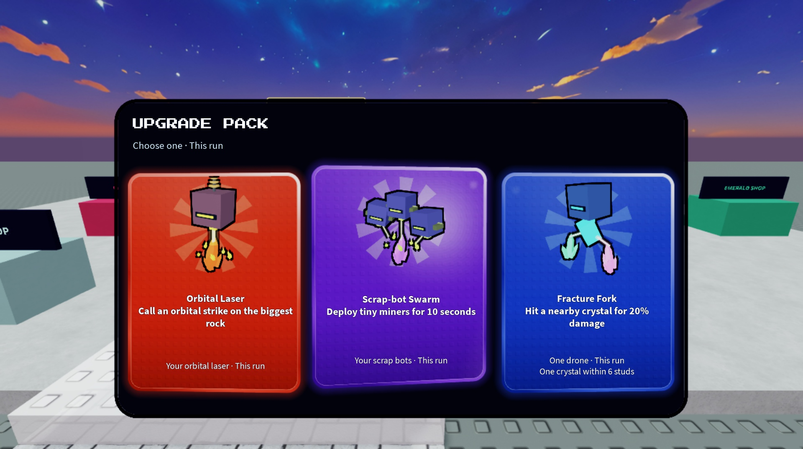

# Pack gradient refinement — November 2

The owner's feedback approves the movement and object outlines while requesting a smoother, more finished surface. This pass changes CardView presentation only. It preserves the existing tilt/lift/reveal equations, model-camera parallax, black artwork outlines, card content, saved offer and server selection.

The old rim mixed a pale lavender cast into every color; each new bevel stays within its own hue and rolls from a small bright catch to a darker lower edge. The face uses a gentle hue-preserving enamel gradient. The stud contrast is lower. Rays and the diagonal sweep are softer. The mouse highlight uses bounded native alpha layers with a smooth radial falloff instead of a colored forcefield particle image. A feathered colored rim glow has twelve physical pixels of transparent space outside the face, preventing a hard clipped glow. The outer curve, inset enamel and texture mask share consistent radii. Physical face rendering is supersampled at three pixels per screen pixel; the existing black model outline remains 2.5 screen pixels wide.

The screenshot uses production CardView/Cards in the native presentation harness with sample G01/G02/D10 choices. It is not a purchase, full production window, gameplay or multiplayer playtest. The production close/header controls are outside the card renderer.

Native checks: 45 catalog choices / 90 labels fit at desktop and compact landscape; a portrait-width check also fits. Pointer input retains the approved tilt and light tracking. Reduced-motion rays and highlights stay static; camera-relative rotation is unchanged and position difference is under 0.00001 studs. A world-space pose comparison would incorrectly count the moving player camera as card motion, so the check uses camera space. UI descendant counts remain stable during idle. Harness cleanup returns to the production baseline (two inactive backing objects, zero leaked harness objects). Unique per-renderer binding names prevent a native review module from replacing the production module’s callbacks. The device simulator is restored to the default viewport after checks.

`python3 tools/test_shops.py /private/tmp/mining-away-luau` passes the current domain/server/persistence checks, source/bundle syntax and exact seven-Source capture preservation. Rendering checks are native evidence for this UI iteration; API-double checks are not engine gameplay tests. `python3 tools/release.py` rebuilds the exact clean revision and verifies the native editable copy's active/backup Sources. Exact commit and artifact hashes are in `build/revision.json`.

No Roblox publishing or main merge. Owner approval of this finish, full selection/confirmation flow, low/high graphics and busy multiplayer performance remain unverified. The independent whole-game visual gate remains NOT VERIFIED.
