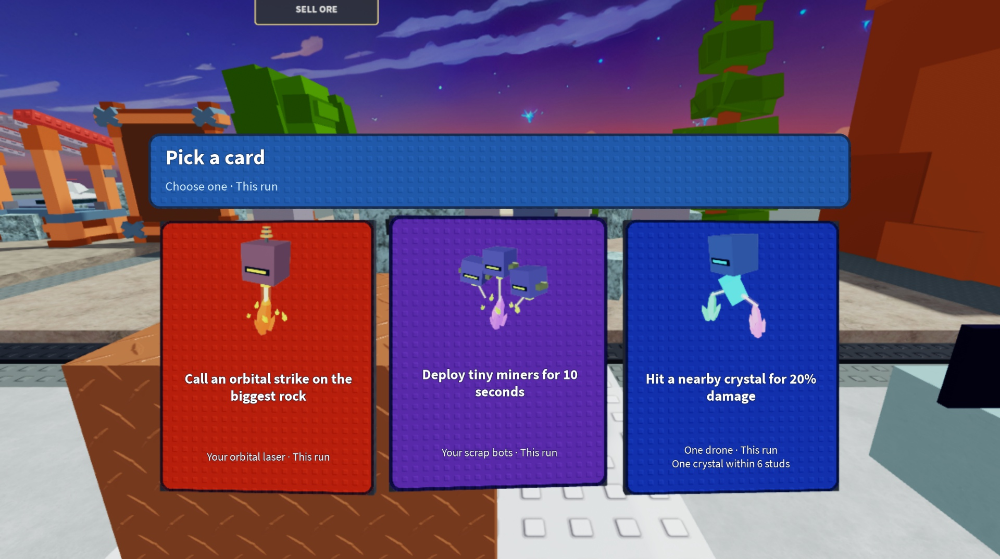
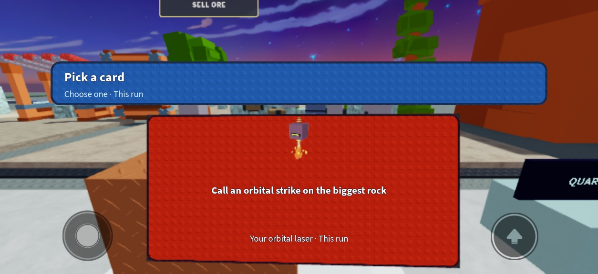

# Simple textured 3D cards

November 2, 2026. Supersedes the decorative card housing in the previous UI review. The owner approved the artwork and requested a closer match to Catch a Brainrot's simple textured surface and rounded border, retaining this game's 3D cards.

Re-inspected the [actual progression-panel screenshot](https://progameguides.com/wp-content/uploads/2026/07/Catch-A-Brainrot-Farming-PlayerXP.jpg?resize=1200%2C675). The implementation keeps three content elements: original mechanic artwork, benefit, and target/terms. Artwork/footer boxes, separators, fasteners, bevel strips and glint/spark decoration are removed. The same simpler surface treatment applies to the existing pack/header housings.

Texture comes from Roblox's shipped `rbxasset://textures/studs.dds` atlas. A few tiled image bands sample its stud region at a consistent small pitch; no per-stud GUI objects, uploaded image, copied reference art or new asset permission is required. A rounded CanvasGroup masks the texture. One inner UIStroke provides the card border. Native inspection caught ImageRect tiling stretching the studs; the final bands correct that. The default square controller selection image is suppressed, leaving the physical border and lift as focus feedback.

The approved original drone/crystal artwork is retained. Actual camera-local Parts, SurfaceGui faces, ViewportFrame artwork and perspective motion remain. Native readback confirmed all three faces enabled, the resting side cards at 2° and the selected center at 3°, with border thickness changing from 3 to 4 screen pixels. The two labels retain crisp native screen rendering and follow the card's lift; they do not become a second 3D surface.

These captures use the actual production CardView, original assets and real catalog in the existing Studio presentation harness, with sample choices. They do not demonstrate a purchase or multiplayer transaction. Native font checks fit all 45 catalog entries / 90 labels at desktop and compact sizes. Existing production-logic regressions and CardView compilation pass. The simulator returned to its default viewport and all harness objects were removed.

The reviewed CardView replacement was installed in the loaded Edit controller using ScriptEditorService.UpdateSourceAsync after an exact previous-source checksum guard; the resulting full client checksum matched the generated bundle. Direct Source assignment rejected the existing controller's greater-than-200,000-byte size, so it was not used to install the change.

The saved editable artifact receives only the allowlisted Source update; source-only releases still derive from the immutable live capture. No publishing, new experience or main merge. Independent visual acceptance, actual mobile-client asset availability, low/high graphics and complete interaction/multiplayer acceptance remain NOT VERIFIED.
