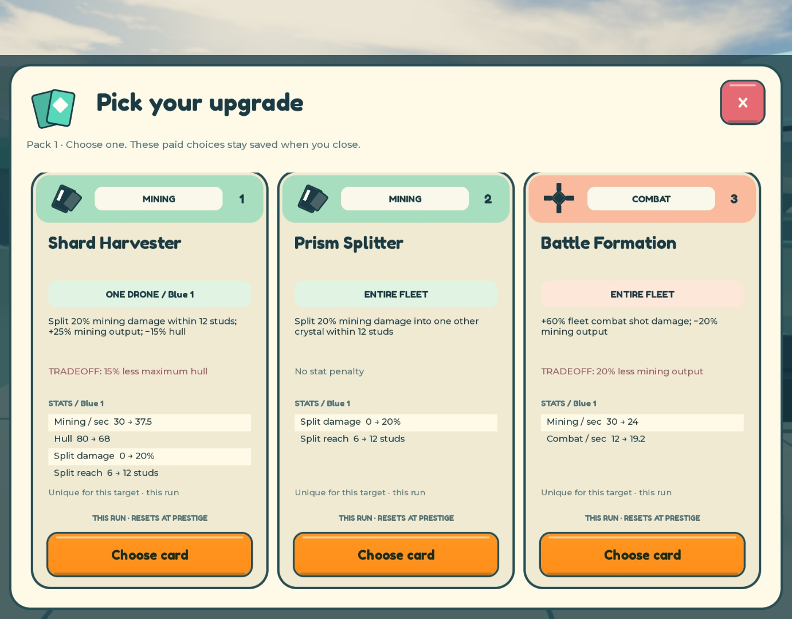

# UI overhaul review — October 25, 2026

This replaces the historical interface direction in `docs/UI_REVIEW.md`. The design follows the owner’s compact-HUD and readable-card requirements, with research from Roblox’s own documented UI examples in [UI_REFERENCES.md](UI_REFERENCES.md). No reference artwork or UI pack was imported.

## Implemented

- Cream surfaces, deep teal text/outlines, mint and amber actions, coral tradeoffs, Fredoka One headings and Gotham body text. The small native icon family is built from Roblox GUI objects.
- Resources, cargo, save status and fleet/card access share one compact HUD. A nearby station or field supplies the relevant contextual action. Recall/Evade and a nearby sentry status stay subordinate to the world.
- A single focused modal handles fleet, run collection, packs, the three saved choices, and prestige. Close/Escape preserve paid choices; the HUD’s card button reopens them.
- Cards expose the actual resolved target, precise description, penalty, up to four changed-stat rows, stacking rule, and prestige expiry. Category labels classify positive benefits, so an upgrade with a hull penalty is not mislabeled as survival. Cards from older paid offers keep their original payload.
- Desktop cards adapt from 430 to 520 pixels so all three selection actions fit the review viewport. Narrow screens stack the full cards in a scroll surface. Small-screen cards omit only the redundant flavor headline.
- Fleet tiles show permanent identity/type and current effective stats. The next-crewmate tile and prestige screen show the sale/clear milestone. Prestige explicitly lists the permanent fleet retained, exactly one added drone, and cards/currency/cargo/run progression reset.
- Transactions disable repeated actions and wait for authoritative state. Client availability reflects distance, station, assault and pending-save state and refreshes while a menu stays open. The server independently enforces every condition. `MA_InAssault` is only a replicated presentation signal.
- Native safe insets, 44-pixel primary controls, compact landscape placement, and a 130-pixel touch-control reserve keep game actions away from movement/jump controls. Modal refreshes preserve scroll position.

Components live in `src/Interface.lua`, `src/UILayout.lua`, `src/CardView.lua`, and `src/Client.lua`; the normal build bundles them into the original client entrypoint. The original drone and crystal renderer remains in that same client.

## Evidence and limits

The full source suite passed with 235 checks, including 31 responsive geometry checks and 39 production-server checks using Roblox API doubles. Four binary checks and four original-asset structural checks also passed. The suite compiled all source and linted both bundles. These checks cover logic and geometry, not engine rendering, live persistence or multiplayer. `tests/ui.studio.lua` supplies a separate native card/font harness for engine checks; its results must be recorded explicitly rather than inferred from compilation.

Actual Studio observations were made in the connected review copy of this one project:

| Check | Observed result and scope |
| --- | --- |
| Native pack flow | Mined 120 Quartz, sold it through the real server command at the Converter, then clicked the new pack controls. The server charged 80 credits, left 40, and returned three saved choices (Core Drill, Clean Extraction, Battle Formation). This pass did not complete a real card selection/reconnect. |
| Desktop three-card rendering | At native safe content 836 × 595, all three 44-pixel Choose targets fitted inside the 443-pixel scroll viewport. A controlled client-only profile fixture exercised a four-row card with a penalty; no durable/server profile was changed. No card TextLabel reported vertical text overflow. |
| Saved-card navigation | Native Close and the HUD card button reopened the same controlled offer ID and its three cards. Away from home, all three actions showed “Return to the depot” and were disabled. A local-client teleport did not establish the home transition, so that particular check remains unverified here. |
| Catalog text metrics | Native TextService measured all 41 standard descriptions and titles at four card widths (240/248/260/284). The longest measured description was 36 pixels high inside a 47-pixel area; none exceeded its measured area. This does not prove every menu or localization fits. |
| Phone landscape | The native iPhone 17 Pro simulator supplied 750 × 323 safe content with touch enabled and keyboard disabled. The HUD and top-right fleet commands stayed clear of the visible joystick/jump controls. Device emulation was reset afterward. |

The screenshot is actual Studio UI rendering with production Cards/UI code and a temporary local rendering fixture. It is not evidence of a randomly earned offer or a multiplayer playtest. UI checks used a coherent committed gameplay/renderer baseline while concurrent map and large-sentry work was underway; the final combined build’s integration status must be read alongside the current map and [sentry report](SENTRY_ANIMATION.md).

Still requiring acceptance: final combined-source desktop/touch walkthrough, real selection/reconnect through the redesigned UI, portrait device rendering and rotation through each menu, gamepad navigation, large fleet/long-number text, real DataStore operation, and two-client/late-join/latency behavior. No publishing was performed. The release command records the exact combined source commit and place checksum in `build/revision.json`; it does not turn these remaining checks into passes.
