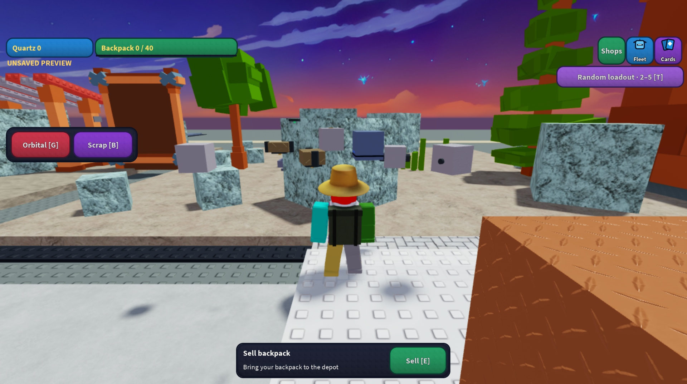
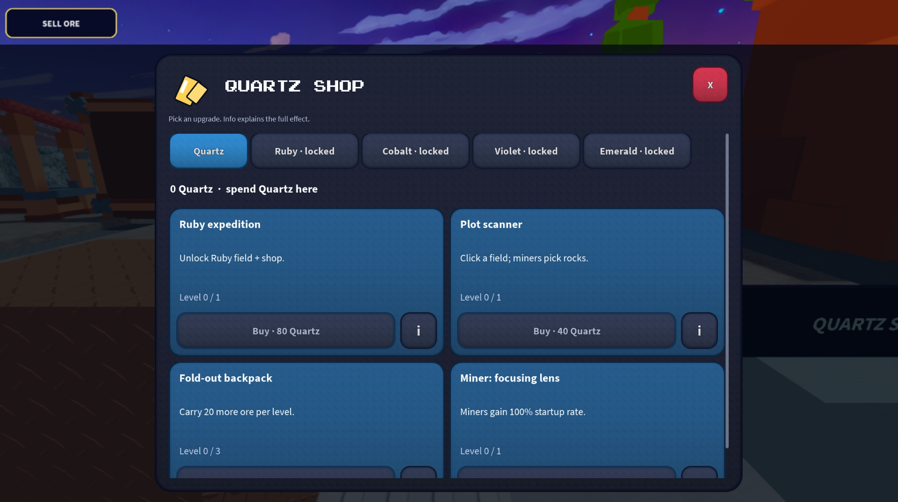

# Unified textured UI — November 2

The owner requests the approved card treatment across the UI: simple, textured, colorful surfaces and useful interaction. Interface now supplies a dark backing, rounded colored surfaces, a restrained enamel gradient, subtle shipped stud texture, clear light copy, and hover/press/controller-focus feedback. The same skin covers the resource counters, navigation, command/status/context panels, notices, gadget controls, shop cells/tabs, fleet/run menus, pack and prestige. Idle gadget instructions collapse; timing instructions appear during use. Fleet stat values sit directly on the colored card rather than in four nested boxes. Short screens use a compact header and pack purchase layout. World labels/health retain compact functional sizing and original assets.

[Actual fleet menu](images/unified-ui-fleet.jpg) · [Production-card renderer with fading rays](images/unified-ui-cards.jpg)

## Flicker changes

The production client now retains the three renderers for an immutable offer through profile/save/notice updates. Busy states update control availability and a shared subtitle; they do not remove the card benefit or dim/reveal all three cards. Reopening/resizing the same offer skips the entrance reveal. Other menus ignore profile changes that do not affect their displayed content. Repeated U.setEnabled calls no longer cancel an ongoing hover tween. Physical face CanvasSize is integer-valued and assigned only when it changes.

The spinning element is now Roblox's shipped `rbxasset://textures/glow.png`, with transparent feathered spokes and outer edges. Its alpha range and transparent corners were checked from the native PNG. It replaces the hard wedge-ray ViewportFrame while retaining the existing card movement and black model outlines. No uploaded texture or copied artwork.

## Native Studio checks

- Production-controller stability fixture: ten local profile changes alternating busy state plus a notice preserve all three card instances and their benefit labels; zero destroyed cards, zero disabled faces and zero canvas resizes. `tools/studio_ui_state_review.lua` restores both local attributes and never sends a gameplay command or changes server/persistent state.
- Production desktop text fit: shop 29, fleet 102, run menu 8, pack 10 and prestige 13 text objects, with zero failures. Real buttons opened these production views; no purchase/prestige was performed.
- Phone landscape simulation: shop and fleet layouts have zero text-fit failures. Native synthetic mouse coordinates needed correction after device simulation; physical mobile touch and gamepad interaction remain unverified. Simulator restored to default.
- Native production CardView catalog: 45 choices / 90 labels pass at desktop, compact 750×315 and 390-pixel portrait-width dimensions. The card screenshot uses sample choices in the native renderer harness, not a live purchase.
- Native shared button: thirty repeated enabled-state updates preserve an active hover color and scale. Forty-five idle renderer frames produce zero face-disable and canvas-resize events. Review harnesses are cleaned and final production console is empty.

## Integration and checks

The owner's explicit coordination authorization is recorded in AGENTS.md. The gameplay-audio chat committed its work separately as `8afa2caea8ad133bdee8135c4826e9adfb82760a` and left shared installation/release ownership to the UI chat. The combined native install updates the four changed allowlisted Sources: GlobalDroneControl, ClientDroneControl, TacticalHUD and DroneRoleEffects. Other live/backup Sources and original chunks remain preserved. The Mac locked before native Save; the existing Studio Edit controller/module Sources are installed and match the generated source. The preserved editable file is refreshed offline from the verified previous source commit 62d7df8, with every non-Source chunk and backup kept byte-identical. This does not claim a native Save action succeeded. See [audio evidence and listening limits](GAMEPLAY_AUDIO.md).

`python3 tools/test_mining_flight.py /private/tmp/mining-away-luau` and `python3 tools/test_shops.py /private/tmp/mining-away-luau` pass the relevant production logic/API-double, syntax and capture-preservation checks. Those are not gameplay or multiplayer playtests. The broad historical test runner has pre-existing source typography/reflow and radius-10 formation assertions inconsistent with the current game; focused current checks and native UI results are reported separately. Reproduce the clean revision with `python3 tools/release.py`; exact commit and hashes are in `build/revision.json`.

No Roblox publishing or main merge. These checks cover the recorded reset/resize flicker paths and this UI iteration; they do not prove every possible pixel flicker, all graphics levels, busy multiplayer performance or independent art approval. Whole-game final visual acceptance remains NOT VERIFIED.
